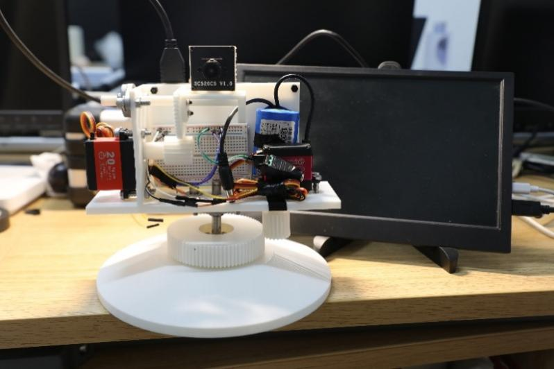
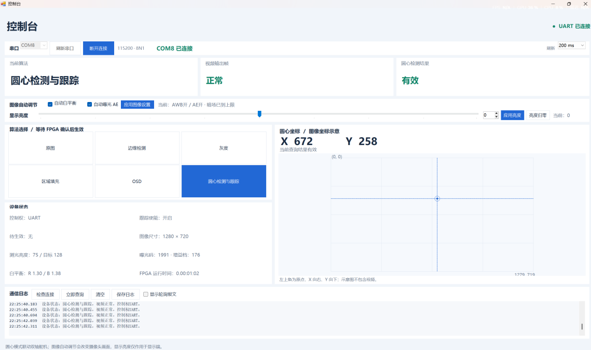

# 慧眸智能视觉跟踪系统

基于安路 PH1P35 FPGA 的实时图像处理与圆形目标跟踪系统。FPGA 完成摄像头采集、图像处理、DDR 帧缓存、目标检测、信息叠加和双轴云台控制；电脑控制台通过串口设置参数和读取状态。

本仓库对应**水平 360° 连续舵机速度控制、俯仰 180° 舵机位置控制**版本。



## 主要功能

- 六种视频模式：摄像头原图、边缘检测、灰度、区域填充、OSD、圆形目标跟踪。
- 检测亮背景中的暗色圆形目标，显示目标框、圆心坐标及跟踪/丢失状态。
- 根据圆心偏差控制水平转向与转速、俯仰角度；退出跟踪时水平停止、俯仰回中。
- 自动白平衡 AWB 开关、帧级增益更新，以及基于摄像头曝光和增益调节的 AE 闭环。
- 显示亮度调节、帧率与内部视频延迟监测。
- Windows 串口控制台：模式选择、AWB/AE 设置、坐标与图像参数查询、日志查看。

## 硬件与开发环境

| 项目 | 配置 |
| --- | --- |
| FPGA | 安路 PH1P35MDG324 |
| 摄像头 | SC520CS，MIPI 双 Lane RAW10 |
| 输入配置 | 1280 × 720，目标 60 fps |
| 视频缓存与输出 | 片外 DDR，HDMI 显示 |
| 水平输出 | C18，连续舵机速度控制 |
| 俯仰输出 | D15，位置舵机控制 |
| FPGA 开发工具 | Tang Dynasty / TD，工程记录版本 6.2.168116 |
| 电脑控制台 | Windows，.NET Framework 4.x，115200 / 8N1 串口 |
| 可选仿真工具 | Python 3、Icarus Verilog（iverilog / vvp） |

## 目录

```text
fpga/
  user_source/       HDL、引脚约束、IP 及初始化文件
  td_project/        TD 工程入口和时序约束
  sim/               仿真用例及舵机回归脚本
  tools/             工程路径配置工具
  doc/               AWB / AE 与串口接口说明
pc_ui/
  src/               C# 控制台和离线测试源码
  tools/             编译与检查脚本
docs/
  images/            实物、控制台截图和流程图
  慧眸智能视觉跟踪系统技术文档.docx
```

## 打开 FPGA 工程

1. 下载或克隆本仓库，完整保留目录层级。
2. 在仓库根目录运行下列命令，设置本机工程目录：

   ```powershell
   python fpga/tools/set_project_path.py
   ```

   此步骤只更新 `.al` 文件的工程目录元信息，不修改 HDL、引脚或时序约束。

3. 在 TD 中打开 `fpga/td_project/camera_to_dsi_display.al`。
4. 核对器件和板卡连接后，执行综合、布局布线及 bitstream 生成。

HDL、IP 配置、ROM 和配套文件均包含在 `user_source` 中，请完整保留。综合输出、日志和历史缓存不纳入版本管理。第三方 IP 与参考设计保留各文件中的原有版权及授权说明。

## 运行电脑控制台

在仓库根目录的 PowerShell 中运行：

```powershell
powershell -NoProfile -ExecutionPolicy Bypass -File pc_ui/tools/Build.ps1
```

编译后，双击 `pc_ui/Launch.cmd` 打开串口控制台，或双击 `pc_ui/Demo.cmd` 进入离线演示。演示模式不打开真实串口。

选择设备对应的 COM 口，波特率为 115200。等待 FPGA 确认模式或图像设置后，界面显示实际状态。AWB、AE 默认开启，显示亮度默认 0；关闭 AE 会保持最近一次曝光与增益。



更详细的说明见 [控制台使用说明](pc_ui/README_UI.md) 和 [图像调节与串口协议](fpga/doc/IMAGE_AUTO_UART.md)。

## 舵机参数

参数位于 `fpga/user_source/hdl_source/design_top_wrapper.v`。

| 参数 | 默认值 | 含义 |
| --- | --- | --- |
| `TRACK_CENTER_US` | 1500 μs | 水平连续舵机停止脉宽 |
| `TRACK_MIN_US` / `TRACK_MAX_US` | 1300 / 1700 μs | 水平速度指令范围 |
| `TRACK_REVERSE` | 0 | 水平转向反转设置 |
| `TRACK_DEADBAND_PIXELS` | 12 | 水平中心死区 |
| `PITCH_MIN_US` / `PITCH_MAX_US` | 500 / 2500 μs | 俯仰位置指令范围 |
| PWM 周期 | 20 ms | 两路独立 50 Hz 输出 |

水平轴的脉宽控制转向与转速，停止脉宽需要按实际连续舵机标定。K4 或退出跟踪模式时，水平轴停止，俯仰轴回到 1500 μs。

水平控制保留坐标滤波、启动确认、加速限制、远端目标启动补偿以及丢失/超时停转逻辑。两轴共用圆心反馈，但采用独立控制实例和 PWM。

## 验证

安装 Icarus Verilog，并让 `iverilog`、`vvp` 位于 PATH 后，在仓库根目录运行：

```powershell
python fpga/sim/run_servo_tests.py
powershell -NoProfile -ExecutionPolicy Bypass -File pc_ui/tools/Test-Ui.ps1
```

舵机脚本运行 9 项回归，覆盖速度控制、运动稳定、边缘目标启动、实际顶层模式退出、手动校准、俯仰控制及 PWM 时序。局部顶层仿真省略摄像头、DDR 和 HDMI 专用 IP；整机实现与时序检查使用 TD。

控制台脚本运行离线协议与界面检查，并生成普通/紧凑窗口预览，不连接实板串口。仿真及界面检查的生成文件位于被忽略的构建目录。

## 技术文档与流程图

- [技术文档](docs/慧眸智能视觉跟踪系统技术文档.docx)
- [设计流程](docs/images/design_flow.png)
- [系统总体框图](docs/images/system_overview.png)
- [AWB / AE 流程](docs/images/awb_ae_flow.png)
- [圆形检测与双轴控制流程](docs/images/tracking_flow.png)

OSD 中的 `LATENCY` 表示同一视频帧从内部采集起点到 HDMI 首像素输出的时间，不包含传感器曝光和显示器成像时间。
